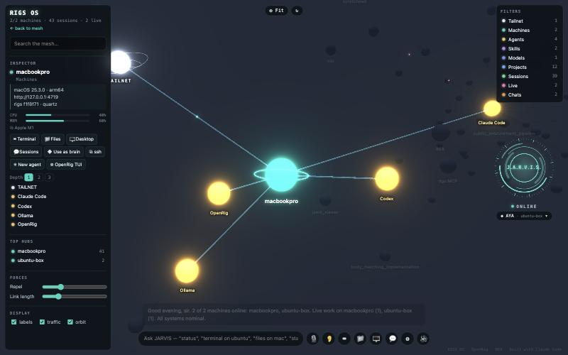

# RIGS OS

A JARVIS-style control plane for every workstation on your Tailscale network. Every machine
(macOS, Ubuntu Wayland, Windows) runs a small node; open the UI on any of them and you get every
machine, every coding agent and every chat session in one 3D "galaxy", plus a voice assistant that
can act on all of them.



## What you get

- **The mesh as a galaxy.** Machines, agents (Claude Code, Codex, Ollama, OpenRig), models,
  projects and live sessions are nodes in a 3D force graph. Click one to focus it, then trace its
  connections 1–3 levels deep.
- **J.A.R.V.I.S.** You can talk to it (push-to-talk, or hands-free with the wake word "Jarvis" and
  barge-in) or type. Answers are spoken. You can switch the brain mid-conversation between Claude
  Code, Codex and any Ollama model on any machine, and the conversation carries over.
- **Choose the brain: machine, provider, exact model, effort.** The core brain defaults to
  Claude Opus 5.5 at high effort. It is JARVIS's voice and the project planner. Any Claude,
  Codex or Ollama model on any machine can be picked from the badge under the orb.
- **Say it once, across projects and machines.** Every machine indexes its code projects (git repos,
  Unity/Godot/Unreal projects, folders with an AGENTS.md or CLAUDE.md) with the title from their guide.
  The router splits a request into its parts and binds each to a folder on a machine, nicknames and
  typos included. "Improve the fps on MadMikeUnity on the linux machine and outline the OpenRig project
  for CyberNinja on the same machine" becomes two projects on that machine. Each is planned against the
  project's own AGENTS.md and staffed by one OpenRig team that adds seats as roles are needed. A part
  that matches no folder isn't filed: JARVIS asks which one you meant.
- **Plan projects and delegate every task.** Describe a goal and the core brain breaks it into
  tasks with dependencies. RIGS routes each task to a machine, provider, model and effort by
  policy:
  - Opus 5.5 for plans, architecture and elaborate code
  - Sonnet 5.5 for simpler algorithms, tests and research
  - Haiku 5.5 for docs and simple text
  - Codex for cross-check reviews of Claude's code
  - Ollama only for work marked private

  Each assignment shows its reason and can be changed per task. Dispatch runs every ready task as
  an **OpenRig** seat (runtime, model and effort set in a generated rig spec, with the task
  delivered as an owned queue item), or directly as an agent in tmux. Dependents start
  automatically when agents report done through the `project_task_update` MCP tool, or when
  they close their OpenRig queue item.
- **Tools, one at a time.** Machines advertise tools such as ComfyUI (auto-detected on :8188 or via
  the `comfy` CLI). You can declare any other tool in ⚙ → Tools. A task that needs a tool is routed
  only to machines that have it, and its brief explains how to use the tool.
- **Terminals on any machine,** in the browser (xterm.js over WebSockets). They are shared, so
  several machines can watch and type into the same one.
- **Every coding and chat session, everywhere.** Claude Code and Codex history, OpenRig seats, tmux
  sessions, RIGS terminals and JARVIS chats from all machines in one list. Read transcripts, type
  into live sessions, or resume a session on the machine where its code lives.
- **"An agent needs you" is impossible to miss.** When any agent on any machine waits for you (a
  Claude Code permission prompt or question, a Codex approval, an OpenRig seat that needs input, a
  blocked project task), its machine's planet and the session blink amber in the galaxy, a banner
  lists every waiting agent with an **Answer** button that attaches you to it, JARVIS says it out
  loud, and a desktop notification appears (browser and the machine's own OS).
- **Agents run in auto mode.** Agents RIGS starts, project tasks and OpenRig seats (`builtin:auto`)
  run unattended: Claude Code in its auto mode, Codex with the `rigs-auto` profile (workspace-write
  sandbox with network, asking only to escalate). Anything that still has to ask shows up as above.
- **App Cloud: any machine's web apps, from anywhere.** Declare a web app in a machine's
  `~/.rigs/config.json` and every JARVIS on the mesh can open it at
  `/api/nodes/<machine>/apps/<id>/`, relayed over the tailnet (see [Sharing a web app](#sharing-a-web-app)).
- **Files on any machine.** Browse, preview, upload, download, rename, trash, and drag-and-drop or
  "copy to machine" between nodes.
- **Easy SSH.** Each node gets a mesh key and `~/.ssh/config` aliases. `ssh <machine>` works from
  every node to every other node (served by OpenSSH; SSH logins open a tmux session JARVIS shows).
- **Hardware-accelerated remote desktop** with Sunshine (host) and Moonlight (client): NVENC, VAAPI,
  QuickSync or VideoToolbox, and KMS capture on Wayland. RIGS pairs them automatically when you
  press 🖥. macOS Screen Sharing (High Performance), RDP and VNC are fallbacks.
- **OpenRig for agent teams.** Rigs and seats show up in the galaxy, `rig tui` opens from anywhere,
  and every peer is registered as an OpenRig host (`rig ps --all-hosts`).
- **Every agent knows REA and the mesh.** `rigs setup` runs `npx rea-agents@latest setup` for every
  detected coding agent. It also registers the `rigs` MCP server, whose `mesh_*` tools let Claude
  Code and Codex run commands, read and write files, drive sessions, start agents and ask other
  machines' brains anywhere on the mesh.
- **Changes ship from any node, without overwriting each other.** An agent on any machine runs
  `rigs dev <topic>`, which gives it its own worktree on a `work/<machine>/<topic>` branch. It
  commits there and runs `rigs propose`. The **merge steward** (one machine with push rights) merges
  proposed branches one at a time onto the latest `main` and runs the build and tests:
  - If the merge is clean and the checks pass, it pushes `main` and every machine updates and
    restarts. A crash-looping update rolls itself back.
  - If there's a real conflict, it hands the conflicting files to a resolver agent (Opus).
  - If the tests fail, the branch goes back to the author with the log.
- **Who may connect:** loopback, Tailscale devices owned by the same Tailscale user (verified per
  request with `tailscale whois`), or peers holding this node's mesh token (for non-Tailscale
  LANs). RIGS binds only to loopback and the machine's Tailscale IPs. It never binds 0.0.0.0
  unless you configure it to.
- **No secrets in the repo.** Tokens and Sunshine credentials live in `~/.rigs/config.json` on each
  machine.
- `rigs setup --https` puts the UI behind `tailscale serve`
  (`https://<machine>.<tailnet>.ts.net`). Browsers only allow the microphone on https or
  localhost.

## CLI

```
rigs setup     make this machine a node (MCP, agent instructions, REA, OpenRig, autostart)
rigs status    list machines           rigs open      open the UI
rigs ssh <m>   ssh to a node           rigs update --all   roll out the latest main everywhere
rigs notify …  speak on every open UI  rigs mcp       stdio MCP server for agents
```

Agents get the same powers through MCP: `project_create` (goal → plan → routing → optional
dispatch), `project_list`, `project_get`, `project_dispatch` and `project_task_update`.

```
```

## Sharing a web app

Add the app to `"apps"` in `~/.rigs/config.json` on the machine that runs it:

```json
"apps": [
  { "id": "szuf", "name": "SZÜF", "icon": "🚗", "port": 8787, "host": "100.82.152.1",
    "healthPath": "/api/status", "launch": { "systemd": "szuf.service" } }
]
```

Use `port` (with `host` when the app doesn't listen on 127.0.0.1) or a full `url`, not both. The
node checks the app's health every 15 s; `GET /api/apps` and the `mesh_apps` MCP tool list every
app on the mesh.

Every daemon serves every app at `/api/nodes/<machine>/apps/<id>/`. If the app runs on this
machine, the daemon forwards to its port. Otherwise it relays the request to the hosting machine's
daemon, which checks the caller the same way it checks any other request. Request and response
bodies stream, so uploads, chunked responses and Server-Sent Events work. WebSockets are piped
through. The hosting daemon makes an app written for `/` work under the prefix:

- `Location`, `Set-Cookie` `Path` (and `Domain`, which it drops) and root-relative
  `src`/`href`/`action`/`srcset` attributes and CSS `url()` are rewritten into the prefix.
- A small script loaded first in `<head>` points `fetch`, XHR, `WebSocket`, `EventSource` and
  `history.pushState` back inside the prefix.
- Root-relative requests that still escape are sent back into the app based on their `Referer`.
- `X-Frame-Options` and CSP `frame-ancestors` are removed so JARVIS can show the app in a window.
- The app receives `X-Forwarded-Prefix`, `X-Forwarded-Host` and `X-Forwarded-Proto`. Mesh tokens and
  Tailscale identity headers are never passed to it.

An unknown app answers 404 and an app that is down answers 502, both as JSON. Optional hints in
`"rewrite"`: `"rootRelative": false` turns off the HTML/CSS rewriting and the script for apps that
already honour `X-Forwarded-Prefix`; `"cookies": false` leaves `Set-Cookie` alone; `"websocket": false`
refuses upgrades. Apps that build URLs relative to the page (`api/x`, not `/api/x`) need none of the
rewriting.

## Developing

See [AGENTS.md](AGENTS.md). `npm test` boots a real node and exercises the API. CI runs it on
macOS, Ubuntu and Windows.
