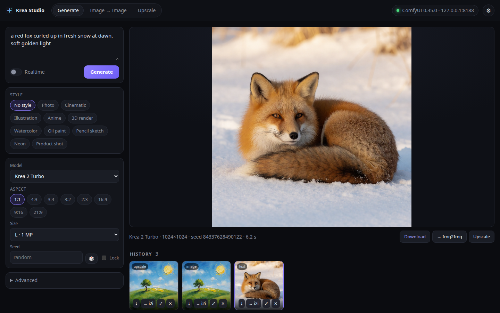

# Krea Studio applet

A Krea-style image studio for JARVIS that runs on **your own ComfyUI**:

- a prompt box with style chips, a model picker, aspect and size, seed (lock or 🎲) and advanced
  sampler / CFG / LoRA settings
- **Generate** (text → image), **Image → Image** from an uploaded image or a sketch canvas with a
  strength slider, and **Upscale** a result (lanczos or an upscale model, plus an optional
  low-denoise *Enhance* pass)
- **Realtime** mode: regenerates while you type or draw, on a debounce. A newer request supersedes
  the stale one in ComfyUI, so prompts never pile up
- live progress (stage, sampling step, previews when ComfyUI sends them) and clear errors for an
  unreachable URL, a refused auth header, a missing model or a ComfyUI node error
- a history gallery with download, send-to-image→image, upscale and delete



## How it fits together

```
JARVIS window ──App Cloud──▶ applet server (this folder, :8732) ──loopback──▶ RIGS daemon
                              static UI, gallery, settings              src/comfyui.js connector
                                                                         /api/local/comfyui/*
                                                                              │ HTTP + /ws
                                                                              ▼
                                                                      the user's ComfyUI
```

- **`src/comfyui.js`** (in the daemon) is the shared ComfyUI connector, also meant for the
  live-video applet. It keeps the URL and auth header in this machine's `~/.rigs/config.json` →
  `comfyui`. It tests a connection (`/system_stats`, `/object_info`), lists checkpoints, UNETs, LoRAs
  and upscalers, builds graphs from the templates in **`src/comfyui-workflows.js`** (txt2img, img2img,
  upscale), queues them with `POST /prompt`, follows them over ComfyUI's `/ws` (with a `/history`
  poll as a backstop) and serves outputs from `/view`.
- Every graph, raw ones included, is checked against `/object_info` before `/prompt`. If a model,
  node or choice is missing, the connector re-reads `/object_info` once and then refuses with a 422
  that names the missing file. Some ComfyUI installs start *downloading* a model that a prompt names
  and is not installed, so a graph like that is never sent.
- A local ComfyUI (loopback URL) takes a lease from the **GPU overseer** on `localhost:8195`
  (`client: comfyui`) before each job, and releases it 20 s after the last one. It never goes around
  the overseer. `gpuOverseer: 'off'` or a URL changes that.
- `/api/nodes/<node>/comfyui/*` reaches the connector on any mesh machine. In the studio,
  Settings → *Connector machine* points the studio at another machine's RIGS and its ComfyUI.

## Run

```bash
node applets/krea-studio/server.js        # http://127.0.0.1:8732/ — needs the RIGS daemon on this machine
```

The server is plain Node 22 ESM with relative URLs only, so it works at `/` and behind the App Cloud
proxy at `/api/nodes/<node>/apps/krea/`. Launch recipe: `rigs-krea-studio.service`, a
`systemctl --user` unit that runs it from `~/.rigs/app`.

Publish it on a machine (App Cloud):

```bash
cp ~/.rigs/app/applets/krea-studio/rigs-krea-studio.service ~/.config/systemd/user/
systemctl --user daemon-reload && systemctl --user enable --now rigs-krea-studio.service
# then MCP mesh_app_register {node, id: "krea", name: "Krea Studio", icon: "✦", port: 8732,
#   healthPath: "/healthz", launch: {systemd: "rigs-krea-studio.service"}}
```

The id is `krea` because magix-system already has a separate `krea-studio` app (a standalone
Python app on :8190, outside this repo).

## Settings

In the studio: ⚙ → **ComfyUI connection**.

| Field | Stored in | Notes |
| --- | --- | --- |
| ComfyUI URL | `~/.rigs/config.json` → `comfyui.url` (per machine) | Any `http(s)://host:port[/prefix]`. Empty = the ComfyUI the capabilities detector finds on this machine; a URL you enter always wins. Nothing is hard-coded. |
| Auth header | `comfyui.authHeader` | `Name: value`, or a bare value for `Authorization`. A **secret**: never returned by any API, logged or put in an error. The UI only shows that one is saved. |
| GPU overseer | `comfyui.gpuOverseer` | `auto` (a local ComfyUI → `http://127.0.0.1:8195`), `off`, or a URL. `comfyui.gpuNeedMb` (default 18000) is the VRAM asked for. |
| Connector machine | `~/.rigs/krea-studio/settings.json` | Which machine's RIGS runs the jobs. |

`comfyui` cannot be changed through the generic `POST /api/local/config`. It goes through the
validated `POST /api/local/comfyui/config`.

Applet server options (env wins over `~/.rigs/config.json` → `kreaStudio`): `KREA_PORT` / `port`
(8732), `KREA_HOST` / `host` (127.0.0.1), `KREA_RIGS_URL` / `rigsUrl` (this machine's daemon),
`KREA_DATA_DIR` / `dataDir` (`~/.rigs/krea-studio`), `galleryMax` (300 images; the oldest are pruned).

## API

The daemon's connector (`/api/local/comfyui/…`, or `/api/nodes/<node>/comfyui/…`):

| Endpoint | |
| --- | --- |
| `GET config` · `POST config` | `{config: {url, auth: {set, name}, gpuOverseer, …}, effective: {url, source}, suggested}`; POST `{url, authHeader \| clearAuth, gpuOverseer, gpuNeedMb, timeoutSec}` |
| `POST test` `{url?, authHeader?}` | `{ok, version, devices, models, presets}` or `{ok:false, error:{code, message}}`, for saved or unsaved values |
| `GET models` | models, presets (Krea 2 when its UNET + text encoder + VAE exist, then each image checkpoint), styles, aspects, sizes |
| `POST jobs` | `{kind: txt2img \| img2img \| upscale, params, lane?}` or `{kind: 'raw', graph}` → a job (`state`, `stage`, `progress`, `outputs`, `error`). 400 bad input, 409 not configured, 422 missing model/node |
| `GET jobs/<id>` · `POST jobs/<id>/cancel` · `GET jobs/<id>/preview` | poll, cancel (queued or running), latest preview image |
| `POST upload?name=` (raw image) · `GET view?filename=&subfolder=&type=` | input images for img2img/upscale; output images |

The applet server: `healthz`, `api/comfy/*` (pass-through), `POST api/generate` (finished
non-realtime jobs go into the gallery on their own), `api/gallery` (list; `POST {jobId}` keeps a
realtime result; `…/<id>/image[?download=1]`; `DELETE …/<id>`), `api/settings`, `api/nodes`.

## Tests and screenshots

- `test/comfyui.test.js`: URL / auth / settings validation (the secret never leaks), the workflow
  builders and graph checks, and round trips against a mocked ComfyUI (HTTP + `/ws`): test
  connection, txt2img with live progress and auth on the socket, missing models refused before
  `/prompt`, realtime lanes superseding stale jobs, execution errors, lost jobs, the GPU overseer
  lease and the HTTP routes.
- `test/krea-studio.test.js`: the applet server against a fake daemon (pass-through, uploads,
  gallery, keep, download/delete, remote machine), the page helpers, and that every element
  `app.js` addresses exists in `index.html`.
- `node applets/krea-studio/scripts/drive.js <url> <steps.json>` drives the studio in headless
  Chrome from a list of steps (`viewport`, `eval`, `waitFor`, `sleep`, `shot`). It made the
  screenshots in `docs/screenshots/krea-studio-*.png` against the real ComfyUI.
