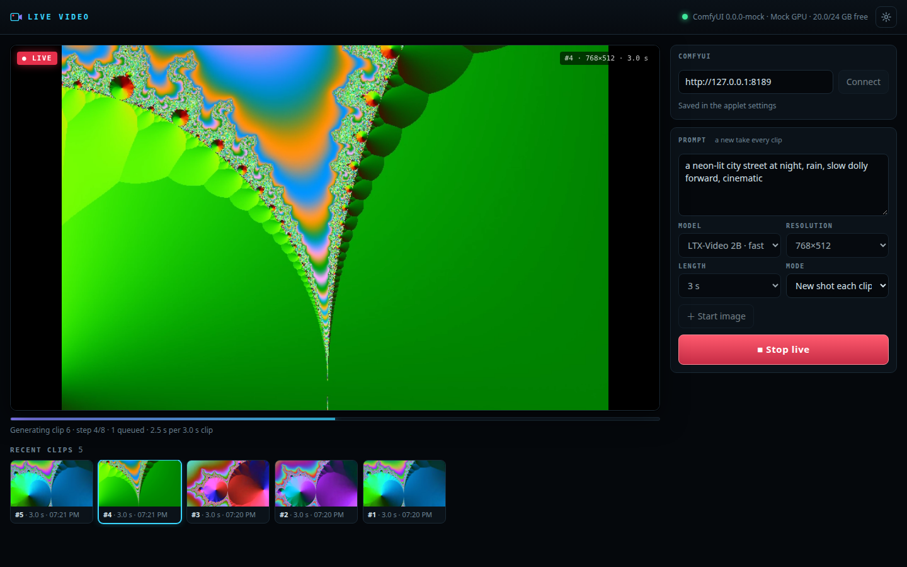

# Live Video applet

Live video generation on **your own ComfyUI**: type a prompt, press **Start live**, and short clips stream
into a seamless player back to back while the next one is already generating.

- a rolling generation loop: the next clip is queued in ComfyUI while the current one plays
- three modes: a new take of the prompt each clip, **prompt drift** (one prompt line per clip) and
  **continuous** (each clip starts from the last frame of the previous one)
- fast workflow templates: **LTX-Video 2B distilled** (text and image to video, up to 1280×704) and
  **Wan 2.1 1.3B** (low-res text to video, up to 1280×720)
- before anything is queued it checks that ComfyUI has every node, model file and option the template
  needs, and shows what is missing (with a download link, or a picker for a file you already have)
- VRAM is leased from the GPU overseer (`localhost:8195`) before loading and released when live stops
- stop interrupts *our* running prompt and removes *our* queued ones, nothing else



Phone (390×844): [live](docs/screenshot-phone.png) · Missing model: [desktop](docs/screenshot-missing.png)

## Run

```bash
node applets/live-video/server.js            # http://127.0.0.1:8741/
```

No build step and no npm install beyond the repo itself (`ws` for the ComfyUI websocket). The server is
plain Node 22 ESM and serves everything with **relative URLs**, so it works both at `/` and behind the App
Cloud proxy at `/api/nodes/<node>/apps/live-video/`.

As a service: the migration `2026-10-17-live-video-applet` (`src/migrations.js`) runs once on every machine
after this is merged. On Linux it installs `rigs-live-video.service` into `~/.config/systemd/user/` with the
checkout's real path and runs `systemctl --user enable --now`; elsewhere it records a `command` launch. Either way it
registers the applet in the App Cloud as **`live-video-comfy`** ("Live Video", port `8741`, `healthPath: "/healthz"`).
The id is not `live-video` because that is already taken on magix-system by a separate Python app (port 8211). By hand:

```bash
mesh_app_register  id=live-video-comfy  port=8741  healthPath=/healthz  launch={"systemd":"rigs-live-video.service"}
```

On Windows the recipe is `launch={"windows":{"command":"node \"C:\\Users\\<you>\\.rigs\\app\\applets\\live-video\\server.js\"","cwd":"C:\\Users\\<you>\\.rigs\\app"}}`
(the migration writes it; the applet itself uses no shell, signals or Unix paths).

It opens at `/api/nodes/<node>/apps/live-video-comfy/`.

GPU overseer (`~/apps/gpu-overseer/clients.json`): the lease is taken in ComfyUI's name (`comfyui` is already a
client), and the applet adds a client of its own so the overseer can see whether it is busy:
`{"id": "live-video-comfy", "name": "Live Video (ComfyUI applet)", "match": "applets/live-video/server.js", "busy": {"url": "http://127.0.0.1:8741/api/busy", "method": "GET"}}`.

### Pointing it at a different ComfyUI

The applet only needs HTTP(S) (and the `/ws` websocket) to a ComfyUI. In the page, put the URL in the ComfyUI
field and press **Connect**, or `PUT api/settings {"comfyUrl": "http://gpu-box:8188"}`:

- **Another machine on the tailnet:** start ComfyUI there with `--listen 0.0.0.0` (or the Tailscale IP) and use
  `http://<machine>:8188`. Set `overseer.mode` to `auto` (the default): it only leases VRAM when ComfyUI is local.
- **A remote host behind auth** (a reverse proxy, RunPod, a hosted ComfyUI): use an `https://` URL, then ⚙ to set the
  token (`authToken`, and `authHeader` if it is not `Authorization`; a bare token is sent as `Bearer …`). The
  token is stored in `~/.rigs/live-video/settings.json` (mode 0600) and never sent back to the page.
- **Models live on that ComfyUI**, not here. The page lists what the chosen template is missing there and
  never queues anything until it has every node and file; a differently named file is picked with
  `models.<family>.<slot>` in the settings.
- Generated clips stay on that ComfyUI and are streamed through this server (`api/view`), so the browser
  only ever talks to the applet.

### Without a GPU: the mock ComfyUI

`scripts/mock-comfy.js` is a fake ComfyUI (HTTP + websocket) with the same API surface. With ffmpeg on
PATH it renders a few colourful 3 s clips, so the player has something to show.

```bash
node applets/live-video/scripts/mock-comfy.js --port=8189 --gen-ms=2500   # add --missing to see the missing-model screen
mkdir -p .rigs-dev/live-video && echo '{"comfyUrl":"http://127.0.0.1:8189","overseer":{"mode":"off"}}' > .rigs-dev/live-video/settings.json
RIGS_NO_OPENRIG=1 RIGS_NO_AUTOUPDATE=1 RIGS_NO_MIGRATIONS=1 RIGS_HOME=$PWD/.rigs-dev node applets/live-video/server.js
node applets/live-video/scripts/screenshot.js http://127.0.0.1:8741/ /tmp/live-video-desktop.png 1440x900 \
  --wait=12 --eval="document.getElementById('start-btn').click()"
```

## Settings

The ComfyUI is user-provided. Settings live in `<RIGS_HOME>/live-video/settings.json` (`~/.rigs` by
default, file mode 0600) and are edited from the page (URL field, ⚙ for auth) or `PUT api/settings`:

| Key | Default | |
| --- | --- | --- |
| `comfyUrl` | unset → the ComfyUI `src/capabilities.js` detects on this machine (`http://127.0.0.1:8188`) | http(s), no `user:pass@` (use the token) |
| `authHeader` | `Authorization` | any header name, e.g. `X-API-Key` |
| `authToken` | unset | **secret**: never returned; `GET api/settings` says `authTokenSet` and `authTokenLength` only. A bare token in `Authorization` is sent as `Bearer <token>` |
| `overseer.mode` | `auto` | `auto` = lease VRAM only when ComfyUI is on this machine; `on`; `off` |
| `overseer.url`, `overseer.client` | `http://127.0.0.1:8195`, `comfyui` | the lease is taken in ComfyUI's name, since ComfyUI is the process that holds the memory |
| `models.<family>.<slot>` | the template's file | use a differently named model file, e.g. `{"ltxv": {"checkpoint": "ltxv-2b-0.9.6-distilled-04-25.safetensors"}}` |

Port and bind address: `LV_PORT` / `LV_HOST`, or `~/.rigs/config.json` → `liveVideo.port|host`
(default `8741` on `127.0.0.1`; the App Cloud proxy reaches it locally).

## API

All routes are relative and answered with `cache-control: no-store`.

| Endpoint | Does |
| --- | --- |
| `GET healthz` | `{"ok":true}` |
| `GET api/settings` · `PUT api/settings` | the settings above, without the token. PUT takes any subset; `authToken: ""` clears it |
| `GET api/status[?refresh=1]` | `{settings, connection:{ok, url, version, devices[{name, vramTotal, vramFree}] \| error}, templates:[{id, label, kind, family, i2v, defaults, limits, resolutions, models, check:{ok, missingNodes, missingModels, badValues}}], live}` |
| `POST api/live/start` | `{template, prompt, mode?: loop\|drift\|chain, resolution?: "WxH", seconds?, fps?, seed?, negative?, image?}` → 202 + state. **409** with `details` when ComfyUI lacks a node, model or option (nothing is queued), 502 when it is unreachable |
| `POST api/live/update` | `{prompt?, mode?, negative?}`: steer the clips not queued yet |
| `POST api/live/stop` | `{interrupted:[prompt ids], deleted:[prompt ids], state}` |
| `GET api/live` | the loop's state: `{status: idle\|starting\|running\|stopping\|error, error, notice, session, pending:[{promptId, index, started, progress}], clips}` |
| `GET api/events` | server-sent events: `state` (as above), `progress` `{promptId, index, value, max}`, `queued`, `clip` `{id, index, url, poster, prompt, seed, template, width, height, frames, fps, duration, genMs, at}`, `notice` |
| `GET api/view?filename=&subfolder=&type=` | a clip or frame streamed from ComfyUI `/view` with the auth added; `Range` passes through for `<video>` |
| `POST api/image` | raw PNG/JPEG/WebP body → uploaded to ComfyUI → `{name}` for `image` in start |

The last 30 clips are kept in `<RIGS_HOME>/live-video/clips.json` (metadata only, the files stay in
ComfyUI's `output/live-video/`).

## Workflow templates

`workflows/<id>.api.json` is a ComfyUI **API-format** workflow (load it in ComfyUI with *Load (API)*).
`workflows/<id>.map.json` is its node map:

```json
{ "id": "ltxv-t2v", "kind": "t2v", "family": "ltxv", "i2v": "ltxv-i2v", "vramMb": 12000,
  "defaults": { "width": 768, "height": 512, "seconds": 3, "fps": 24 },
  "limits": { "sizeStep": 32, "maxWidth": 1280, "maxHeight": 720, "framesStep": 8, "framesOffset": 1, "maxFrames": 257 },
  "resolutions": [[512, 288], [768, 512], [960, 544], [1280, 704]],
  "params": { "prompt": [{ "node": "6", "input": "text" }], "seed": [{ "node": "72", "input": "noise_seed" }], "frames": [...], "fps": [...], ... },
  "models": { "checkpoint": { "node": "44", "input": "ckpt_name", "url": "https://huggingface.co/…", "dir": "checkpoints" } },
  "outputs": { "video": "80", "lastFrame": "91" } }
```

| Template | Models (in `ComfyUI/models/…`) | Size / length | Notes |
| --- | --- | --- | --- |
| `fasth3-t2v` FastH3 · 8 steps (with sound) | `diffusion_models/fastvideo_fasth3_8step_v2_pruned_int8_convrot.safetensors`, `text_encoders/qwen3vl_32b_minimax_h3_nvfp4_awq.safetensors`, `vae/minimax_h3_video_vae_int8_convrot.safetensors`, `vae/minimax_h3_audio_vae_fp32.safetensors` | multiples of 32 up to 1280×704, 17k+5 frames at 24 fps | MiniMax H3 distilled to 8 steps; needs ComfyUI-MiniMax-H3 nodes (`MiniMaxH3ImageToVideo`…) and ~20 GB VRAM. Clips have audio (mp4). `fasth3-i2v` is its start-frame partner. About 40 s per 3 s clip at 864×480 on an RTX 4090 |
| `ltxv-t2v` LTX-Video 2B · fast | `checkpoints/ltxv-2b-0.9.8-distilled.safetensors`, `text_encoders/t5xxl_fp16.safetensors` | multiples of 32 up to 1280×704, 8n+1 frames at 24 fps | 8 steps, cfg 1. About real time on a 4090 at 768×512 |
| `ltxv-i2v` (used automatically) | same | same | start frame → video: an uploaded image, or the previous clip's last frame in continuous mode |
| `wan21-t2v` Wan 2.1 1.3B · low-res | `diffusion_models/wan2.1_t2v_1.3B_fp16.safetensors`, `text_encoders/umt5_xxl_fp8_e4m3fn_scaled.safetensors`, `vae/wan_2.1_vae.safetensors` | multiples of 16 up to 1280×720 (trained at 832×480), 4n+1 frames at 16 fps | 20 steps, uni_pc. No image-to-video: continuous mode falls back to drift |

The LTX and Wan templates use only core ComfyUI nodes (FastH3 needs the MiniMax H3 ones). The clip is saved with `SaveWEBM` (VP9) and the last frame
comes out of `ImageFromBatch` → `PreviewImage` (a temp file), which continuous mode uploads as the next
start image. A template is added by dropping a new `.api.json` + `.map.json` pair into `workflows/`.

**Missing things are never fetched implicitly.** Some ComfyUI setups (e.g. with a model-downloader
custom node) start downloading any model a submitted workflow names, many GB at a time. The applet
therefore checks a fresh `/object_info` before *every* start and queues nothing until each node class,
model file and fixed option (sampler, scheduler, encoder type, codec…) is there. The page lists what is
missing, links the download and offers the installed files of the same kind instead.

## The live loop

`live.js` runs one session at a time:

- **Pipelining.** Up to two of our prompts are in ComfyUI's queue: one running, the next waiting. So the
  GPU never idles between clips and the next clip is generating while the browser plays the current one.
  Continuous mode keeps one in flight, because each clip needs the previous one's last frame.
- **No runaway.** The server estimates the playhead (clips play back to back from when they arrive)
  and stops submitting once about three clips are buffered ahead. A fast GPU doesn't fill the disk with
  clips nobody will watch.
- **Events.** Progress and results come over ComfyUI's `/ws?clientId=` (a `live-video-<uuid>` id, auth
  header included). `/history/<id>` is polled as a backstop when the socket is down.
- **Failures.** A failed clip is reported and skipped. Three in a row stop the loop with the reason.
- **Stop.** It deletes our queued prompts first: once the running one is interrupted, ComfyUI starts the
  next in line straight away. Then it calls `/interrupt` with our running prompt's id, but only if the
  running prompt is ours (from `/queue`). It also closes the socket and releases the VRAM lease.
- **VRAM.** Before the first clip it does `POST :8195/api/acquire {client: "comfyui", need_mb}`, where
  `need_mb` is the template's `vramMb`. That lease is refreshed every 10 minutes while live, and
  `api/release` runs on stop or error. If the overseer is down or can't free enough, live still runs, with
  a warning: ComfyUI offloads what does not fit.

## The page

`public/index.html`, `style.css`, `app.js`, plain ES modules:

- **Top bar:** connection status (ComfyUI version, GPU, free VRAM) and ⚙ for URL, auth and overseer.
- **Player:** two stacked `<video>` elements. The hidden one preloads the next clip and is revealed
  on its first `playing` frame when the visible one ends, so there's no black flash between clips. If the
  next clip isn't ready yet, the last frame holds with "next clip generating…". When idle, the clip on
  screen loops.
- **Below the player:** the progress bar (step x/y of the clip generating, how many are queued,
  seconds of generation per clip) and the recent-clips strip (last-frame thumbnails; tap to replay).
- **Controls:** the ComfyUI URL, the prompt, model, resolution, length and mode, a start image, and
  Start/Stop. While live, editing the prompt or mode steers the next clips (`api/live/update`). On phones,
  Start/Stop is pinned to the bottom of the screen.
- **Saved in the browser:** the form, in `localStorage` (`lv.form`).

## Tests

`npm test` runs `test/live-video.test.js` against the mock (no network, no GPU):

- **Templates:** every map points at real nodes, presets are valid, values land on the mapped inputs,
  the frame and size constraints hold, and model overrides work.
- **The check:** missing nodes, missing models (with what's available), bad options in old and new
  `COMBO` formats. A start with something missing gives 409 and **no `/prompt`**.
- **Settings:** validation, persistence under `RIGS_HOME` (0600), the detected default, the token
  never echoed, and the auth header on HTTP and the websocket.
- **The live loop:** the second prompt is queued before the first finishes, it never runs away, drift and
  update work, chain uploads the last frame, image-to-video works, and failures are handled.
- **Stop:** `/interrupt` names our prompt, the queued one is deleted, and a foreign running job is left
  alone.
- **Overseer:** acquired before the first prompt and released on stop. The overseer client speaks its
  API.
- **Server:** `healthz`, relative URLs, every `#id` that `app.js` uses exists, `/view` with `Range`, path
  traversal refused, and ComfyUI down or unset.
