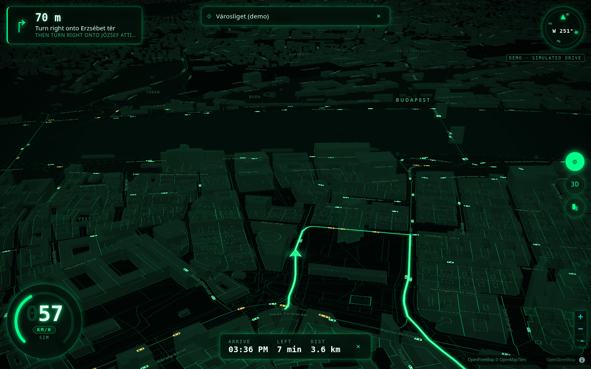
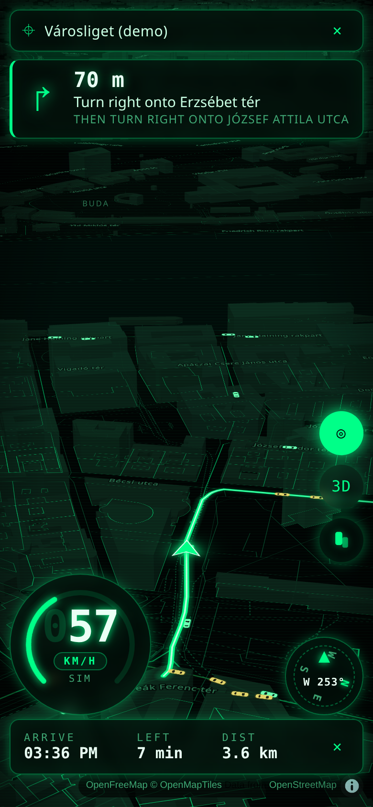
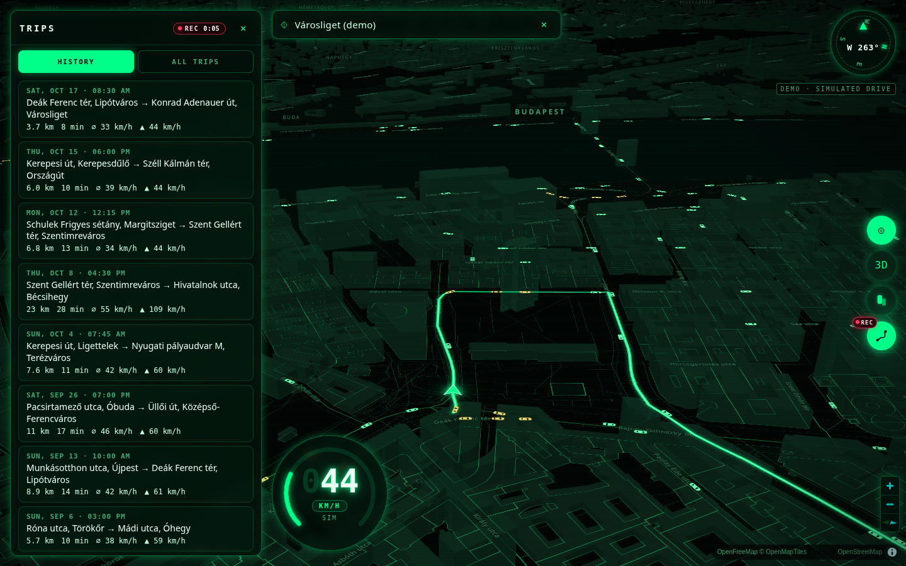
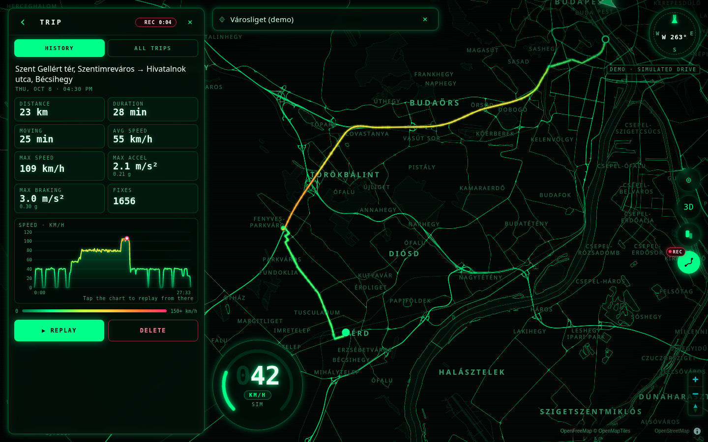
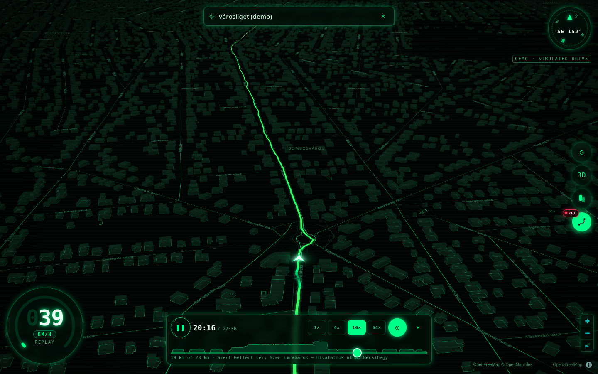
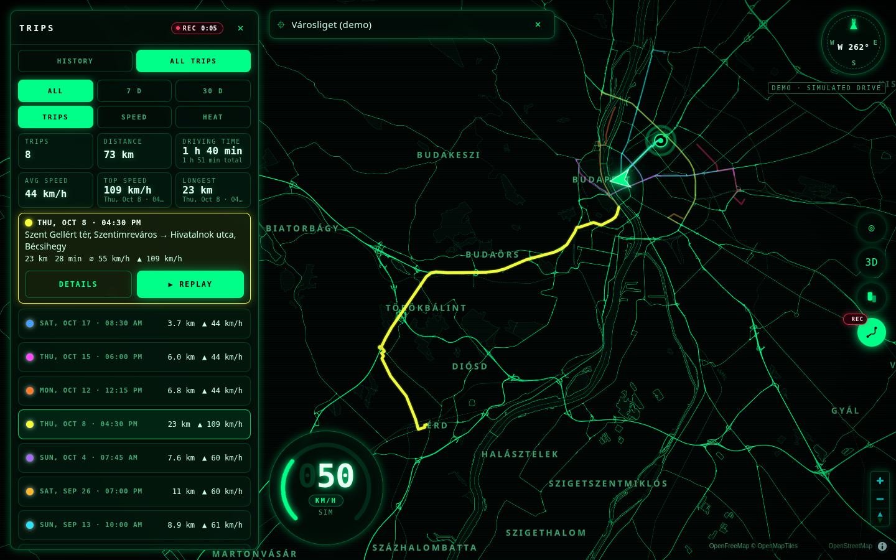

# Navigation applet

A dark, 3D, green-vector navigation map for JARVIS. It has:

- tilted vector map, near-black base, neon-green outlines for roads, water, parks and buildings
- translucent extruded buildings and a glowing green route
- live speed readout (km/h ⇄ mph), heading compass, next-turn card and ETA
- a follow-me camera that eases to your position and direction of travel
- traffic: streets shaded darker where traffic is heavy, and little car silhouettes moving around you,
  more and slower on congested roads (see [Traffic](#traffic))
- trip recording: every drive while the page is open is saved on this machine with its distance,
  speeds and accelerations, and a Trips panel to look back: history, each trip's route coloured by
  speed with a speed chart, replay, and every trip on one map with the totals (see [Trips](#trips))

All data is **free and needs no API key** (live traffic can use an optional free key):

| What | Service | Notes |
| --- | --- | --- |
| Map tiles | [OpenFreeMap](https://openfreemap.org) vector tiles (OpenMapTiles schema, OpenStreetMap data) | No key, no registration. Attribution shown on the map. |
| Map engine | [MapLibre GL JS](https://maplibre.org) 5.24.0 from unpkg (fallback jsDelivr) | WebGL; renders 3D extrusions and pitch. |
| Routing | [OSRM](https://project-osrm.org) public demo server (`router.project-osrm.org`) | Driving profile, turn-by-turn steps. |
| Search | [Photon](https://photon.komoot.io), falling back to [Nominatim](https://nominatim.org) | Photon supports search-as-you-type; Nominatim is only asked when Photon fails. |
| Traffic (live) | [TomTom Traffic Flow vector tiles](https://docs.tomtom.com/traffic-api/documentation/tomtom-maps/traffic-flow/vector-flow-tiles) (`relative` flow) | Only with a free TomTom key (`NAV_TOMTOM_KEY`). Free tier: 200K tiles/month, no credit card. Shown as "Traffic © TomTom". |
| Traffic (assumed) | Synthetic model over the OpenFreeMap road network: road class × time of day × closeness to your route | No key. Used when there is no key, TomTom fails or the daily budget is spent. Choice and formulas: [`docs/traffic-source.md`](../../docs/traffic-source.md). |

The browser only fetches tiles, fonts and MapLibre itself. Search, routing and traffic go through this
applet's server, which:

- caches results for 10 minutes
- spaces Nominatim calls at least 1.1 s apart
- sends an identifying `User-Agent`

That keeps us inside the public services' usage policies for personal, low-volume use. For heavy use,
point the URLs at your own OSRM, Photon or Nominatim (see Configuration).



## Run

```bash
node applets/navigation/server.js              # http://127.0.0.1:8731/
# then open http://127.0.0.1:8731/?demo=1      # simulated drive, no GPS needed
```

No build step and no npm install beyond the repo itself. The server is plain Node 22 ESM and serves
everything with **relative URLs**, so it works both at `/` and behind the App Cloud proxy at
`/api/nodes/<node>/apps/navigation/`.

| Endpoint | Returns |
| --- | --- |
| `GET healthz` | `{"ok":true}` |
| `GET config.json` | `{tiles, glyphs, demo, traffic:{source}, provider}`: the public endpoints the browser loads; `traffic.source` is `tomtom`, `synthetic` or `off` (never the key) |
| `GET api/search?q=…&near=lon,lat` | `{results:[{label, detail, lon, lat}]}` |
| `GET api/route?from=lon,lat&to=lon,lat` | `{distance, duration, geometry:[[lon,lat]…], steps:[{type, modifier, name, location, distance, duration}], limits, routeId}`; `limits` is OSRM's per-segment km/h (`null` entries = unknown) or `null` when the server sends none |
| `GET api/route/limits?route=routeId` | `{routeId, source:'osrm'\|'overpass'\|'none', limits:[km/h\|null per route segment]\|null}`; always 200 for a known route, 404 once the routeId expired. See [Speed limits and cameras](#speed-limits-and-cameras) |
| `GET api/speedcams?bbox=w,s,e,n` or `?route=routeId` | `{source:'overpass', status:'ok'\|'partial'\|'unavailable', cameras:[{id, lat, lon, maxspeed km/h\|null, direction deg\|null}], error?}`; always 200 for a valid request, empty `cameras` and `status:'unavailable'` when Overpass is down |
| `GET api/traffic?bbox=w,s,e,n&z=…[&route=routeId][&tz=IANA zone][&source=synthetic][&at=ISO time]` | `{source, updated, z, clipped, segments:[{id, coords:[[lon,lat]…], class, congestion 0..1, speedKmh, oneway?}]}`, see [Traffic](#traffic) |
| `api/trips…` | recorded trips: upload, list, detail, totals, delete, see [Trips](#trips) |

### Demo mode

`?demo=1` fetches a real route through central Budapest, from Deák tér up Andrássy út to Városliget. A
simulated vehicle drives it at 5 Hz:

- it speeds up, cruises between roughly 30 and 75 km/h, and brakes for each turn
- the speed readout, compass, next-turn card, ETA and 3D follow camera all run exactly as with GPS
- at the end it loops

Searching for a destination in demo mode drives there instead. If the routing service is down, the demo
falls back to a built-in line, so it still works.

The demo also shows traffic round the car. Without a TomTom key it asks the assumed-traffic model for
the latest weekday at 17:30 (`at=`), so the evening rush is visible whenever you open it.

## Install from the app store

`store.json` is the app-store manifest: id `navigation`, port `8731`, health path `healthz`, Node `>=22`,
about 50 MB, no GPU. **Navigation needs no Python venv and no model download** (`python: null`,
`venv: false`, `models: []`), so an installer skips its generic venv and model steps.

`installPlan(manifest, {platform, installDir, rigsHome, nodePath, unitTemplate})` in
[`src/store.js`](../../src/store.js) is a pure function (no fs, no spawn) that turns the manifest into:

- **Linux**: a `systemd --user` unit generated from `rigs-navigation.service.tmpl` with the real install
  path, Node binary and data dir (nothing machine-specific), written to `~/.config/systemd/user/` and
  started with `systemctl --user enable --now rigs-navigation.service`
- **macOS / Windows**: a launch command and working directory
- the app registration payload (`mesh_app_register` / `POST /api/local/apps`), for example
  `{id:'navigation', port:8731, healthPath:'/healthz', launch:{systemd:'rigs-navigation.service'}}`
- the trips data dir, `<RIGS_HOME>/navigation/trips`. **Uninstall keeps it** unless purged.

Optional setting: `NAV_TOMTOM_KEY` (secret) for live traffic. The unit reads it from
`<RIGS_HOME>/navigation/env` (`EnvironmentFile=-…`), so the key is never written into the unit or the repo.
Without it traffic is assumed.

`test/navigation-store.test.js` validates the manifest, checks the plans for linux, darwin and win32, and
does a scratch install in a temp `RIGS_HOME` that starts `server.js` from the generated command and
expects `{ok:true}` from `/healthz`.

## Configuration

Everything is optional. Environment variables win over `~/.rigs/config.json` → `navigation`, which wins
over the defaults:

| Env | `navigation.<key>` | Default |
| --- | --- | --- |
| `NAV_PORT` | `port` | `8731` |
| `NAV_HOST` | `host` | `127.0.0.1` (the App Cloud proxy reaches it locally) |
| `NAV_TILES_URL` | `tilesUrl` | `https://tiles.openfreemap.org/planet` (TileJSON, OpenMapTiles schema) |
| `NAV_GLYPHS_URL` | `glyphsUrl` | `https://tiles.openfreemap.org/fonts/{fontstack}/{range}.pbf` |
| `NAV_ROUTING_URL` | `routingUrl` | `https://router.project-osrm.org` |
| `NAV_SEARCH_URL` | `searchUrl` | `https://photon.komoot.io` |
| `NAV_NOMINATIM_URL` | `nominatimUrl` | `https://nominatim.openstreetmap.org` |
| — | `demo.from`, `demo.to` | `[19.0548, 47.4979]` → `[19.0838, 47.5155]` (`[lon, lat]`) |
| `NAV_TRAFFIC_SOURCE` | `trafficSource` | `auto`: TomTom when a key is set, else assumed traffic. Also `tomtom`, `synthetic`, `off` (hides the toggle) |
| `NAV_TOMTOM_KEY` | `tomtomKey` | unset. **Secret**: stays on the server, never in `config.json`, logs or errors |
| `NAV_TRAFFIC_DAILY_TILES` | `trafficDailyTiles` | `5000` TomTom tiles per UTC day, then assumed traffic until midnight UTC |
| `NAV_TOMTOM_URL` | `tomtomUrl` | `https://api.tomtom.com` |
| `NAV_OVERPASS_URL` | `overpassUrl` | `https://overpass-api.de`: speed cameras and the road-limit fallback |
| `NAV_DATA_DIR` | `dataDir` | `~/.rigs/navigation/trips` (under `RIGS_HOME` when set): where recorded trips are stored |
| `NAV_REVERSE_GEOCODE` | `reverseGeocode` | `true`: name trip ends through the search service. `0`/`false` keeps every trip coordinate on this machine; the panel shows coordinates |

```json
{ "navigation": { "demo": { "from": [13.3777, 52.5163], "to": [13.4050, 52.5200] } } }
```

Any OpenMapTiles-schema source works for `tilesUrl`. That includes a self-hosted OpenFreeMap or
Planetiler build, or MapTiler with your own key in the URL. If you put a key there, keep it in
`~/.rigs/config.json` or the environment, never in this repo. Invalid values are ignored with a log
warning that names the setting but not its value.

## Speed limits and cameras

Server side (`speedcams.js`) and the pure rules the browser applies (`public/speedwarn.js`):

- **Cameras**: OSM `highway=speed_camera` and `enforcement=maxspeed` nodes, plus the `device` nodes of
  enforcement relations (the relation's `maxspeed` is inherited). Red-light cameras
  (`enforcement=traffic_signals` etc.) are dropped. `direction` / `camera:direction` is read as the
  direction of travel the camera enforces; `forward`/`backward` have no bearing and come back `null`.
  Overpass answers are cached for 6 h on a 0.05° grid; a failure is not retried for 30 s.
  `bbox` may span at most 0.5° a side.
- **Road limits**: the route request asks OSRM for `annotations=maxspeed` (a server that rejects it still
  routes). When OSRM has no limits, `api/route/limits` matches Overpass `maxspeed` ways to each route segment
  (nearest way within 30 m running the same way). Routes longer than about 150 km only get limits for their
  first 150 km. Values are normalised to km/h: `50`, `30 mph` (→ 48), implicit `RO:urban`-style values for
  the countries listed in `speedwarn.js`; `none`, `signals`, unknown zones → `null`.
- **`speedwarn.js`** (ESM, no DOM): `parseMaxspeed`, `currentLimit(routeProgress, limits)` (`routeProgress` is
  `geo.routeProgress`, which now also returns the segment `index`), `nearestCameraAhead(pos, heading,
  cameras)` (≤800 m, ±40° of the heading, and inside the camera's direction ±60° when it has one) and
  `warningState({speedKmh, limitKmh, camera, distanceM})` → `none` | `speeding` | `camera-near` |
  `camera-speeding`. Speeding means over the limit by more than 3 km/h or 5 %, whichever is larger. A
  camera counts inside a radius of 300 m (≤30 km/h) growing to 800 m (≥130 km/h), and its own `maxspeed`
  replaces the road limit then. With no known limit nothing is "speeding".

## The look

The style lives in `public/mapstyle.js`, built in code over the OpenMapTiles layers:

- background `#010403`
- parks and water filled near-black
- roads as `#00ff88`-family strokes; width and brightness go up with road class
- water, park and building edges as thin green lines
- buildings as dark-green translucent extrusions, footprint lines drawn on top
- road, place and water labels in muted green `#3fa774`
- no POI, house-number or peak layers

Change `PALETTE` there to retune it. Traffic shading is `TRAFFIC_SHADE` in the same file.

## Traffic



- **Street shading.** A dark veil over each road stroke, by congestion. Free flow leaves the normal
  green alone. Heavier traffic dims it toward a deep, slightly rust-tinted olive (bands at 0.25, 0.5,
  0.75, 1). It sits under the buildings, the labels and the route, so those stay readable.
- **Cars.** Small top-down silhouettes, drawn as a MapLibre symbol layer from one GeoJSON source and
  updated from one `requestAnimationFrame` loop at up to 30 Hz. There are no DOM markers. Cars are
  heading-aligned and lie flat on the map (`icon-rotation-alignment` and `icon-pitch-alignment: map`),
  so they stay on their streets when you rotate or tilt.
  - **Density:** `2 + 18·congestion` cars/km, halved on minor roads.
  - **Speed:** the road's `speedKmh`, ±6% per car. Cars on heavy roads (≥ 0.5) are amber.
  - **Movement:** cars keep right on two-way roads and turn onto connected roads at the end of a
    segment.
  - **Limit:** at most 260 cars (160 on phones), nearest the vehicle first.
- **Fetching.** The browser asks for a box of about 900 m round the vehicle, snapped to a 0.005° grid,
  so small moves reuse the last answer. It refetches when that box, the zoom band or the route changes,
  or after 60 s. It checks on `moveend` (trailing 500 ms timer) and every 15 s, and nothing runs while
  the tab is hidden.
- **Toggle.** The car button under 3D turns traffic on and off. The setting is remembered in
  `localStorage` (`nav.traffic`).
- **Server.** `api/traffic` serves z12–14 tiles (at most 16, nearest the bbox centre first; `clipped:
  true` says so) and keeps only the roads touching the bbox. It caches:

  | What | How long |
  | --- | --- |
  | OpenFreeMap road lines | 24 h, decoded, in memory, at most 64 tiles; TileJSON re-read every 6 h |
  | TomTom tiles | 60 s, in memory only (TomTom terms: ≤ 24 h) |

  It also shares identical in-flight fetches. When TomTom fails it switches to assumed traffic:

  | TomTom result | Assumed traffic for |
  | --- | --- |
  | 429 | 15 min |
  | 401 or 403 | the rest of this run, with one log line naming `NAV_TOMTOM_KEY` |
  | any other error, or the daily budget spent | this request (the budget resets at midnight UTC) |

  If even the road geometry can't be loaded, it answers `{"source":"none","segments":[]}` and the map
  just shows no traffic. Large answers are gzipped.
- **Assumed traffic** is deterministic. Per road, it is a pure function of road class, local time (a
  one-minute bucket in the browser's time zone) and distance to the active route. So polls don't
  flicker, and the route you drive is a little busier, as the fast path usually is.
- **Formulas, rejected sources and TomTom details:** [`docs/traffic-source.md`](../../docs/traffic-source.md).

## Trips

Every drive is recorded while the navigation page is open, so you can look back at it later: distance,
duration, average and top speed, and the hardest acceleration and braking.

- **On by default** with GPS. `?record=0` turns it off for that page. The demo records only with
  `?demo=1&record=1`, which is how you test it without driving.
- **Data stays on this machine.** Trips are stored by the applet server in `NAV_DATA_DIR`
  (default `~/.rigs/navigation/trips`), one JSON file per trip. The browser talks only to its own
  applet server. The one exception: to name a trip's start and end, the Trips panel asks
  `api/reverse`, which sends those two points, rounded to ~10 m, to the search service (Photon,
  then Nominatim), once per trip. `reverseGeocode: false` turns that off.

### The Trips panel

The Trips button (the route icon under the traffic toggle) opens it. It is a side panel on wide screens and a bottom sheet
on phones (tap the grip to make it taller). Live navigation and recording carry on underneath. While
a trip records, a red **REC** badge sits on the button and a REC chip with the elapsed time shows in
the panel.

- **History**: trips newest first, with date and time, start → end, distance, duration, average
  and top speed. Places are named once through `api/reverse` and saved with the trip (`PATCH`).
  Until then the row shows coordinates. Every number follows the km/h ⇄ mph toggle.
- **Trip**: the route on the map coloured by speed (dim green when crawling, neon in town, yellow
  and amber faster, hot pink past 150 km/h), start and end marks, and tiles for distance, duration,
  moving time, average and max speed, max acceleration and max braking. Below them is a speed-over-time chart (SVG):
  hover or drag to read it, tap to replay from that moment. Delete asks first, then moves the file
  to `trash/`.
- **Replay**: a white car and the follow camera move along the recorded track by its real
  timestamps, at 1×, 4×, 16× or 64×. Play/pause (Space), and scrub on the bar, which shows the trip's
  speed profile. The speed gauge reads `REPLAY` and the compass turns with the replayed heading.
  Dragging the map stops the camera following; ◎ resumes it. ✕ (or Esc) leaves the replay and
  returns to live navigation.
- **All trips**: every trip on the map at once, each in its own colour (chosen to stand out from the
  green roads). Hover or tap a trip, or its row, to highlight it and see its numbers, then open it or
  replay it. The totals card (`api/trips/summary`) shows trip count, distance, driving time (and total
  time), overall average, top speed and the longest trip. **All / 7 d / 30 d** filter by start date.
  **Trips / Speed / Heat** switch between colour per trip, all tracks coloured by speed, and a heat
  map of where you drive most.

Code: `public/tripsui.js` (panel, map layers, replay), `public/tripsview.js` (colours, replay
interpolation, chart geometry and labels; pure, unit-tested). `window.__navTrips` exposes
`open('list'|'all')`, `show('detail', id)`, `startReplay(seconds)`, `setRate(n)`, `seek(seconds)`,
`exitReplay()` and `close()` for screenshots and debugging.






Phone (390×844): [list](docs/screenshot-trips-list-phone.png) ·
[detail](docs/screenshot-trips-detail-phone.png) · [replay](docs/screenshot-trips-replay-phone.png) ·
[all trips](docs/screenshot-trips-all-phone.png)

### What gets recorded

The recorder (`public/trips.js`) sits on the same position stream as the HUD:

| Rule | Value |
| --- | --- |
| Drop a fix | accuracy worse than 50 m; or moved under 3 m while under 1 km/h (GPS wobble while parked) |
| Keep rate | at most one fix per ~second (the 5 Hz demo is thinned to 1 Hz) |
| A trip starts | above 5 km/h, including the ~10 s before as pre-roll. Without `coords.speed`, speed is the displacement over ≥ 5 s |
| A trip ends | after 5 minutes without moving (> 3 km/h), or when the page closes (`pagehide`) |

Fixes are stored as `{t, lat, lon, speed, heading, accuracy, alt}`. `t` is in epoch ms, speeds in m/s.

### Nothing lost offline

- Every ~15 s the new fixes become a numbered chunk in an outbox in `localStorage`
  (`nav.trips.outbox`). Chunks are posted in order.
- If the server is unreachable or answers 5xx, the chunks wait there, across reloads, and go out
  once it answers (every 5 s, and on the browser's `online` event).
- When the tab is hidden or the page closes, the outbox goes out with `navigator.sendBeacon`, up to
  60 KB. The rest waits for the next visit.
- Fixes not yet in a chunk are saved with the open trip (`nav.trips.current`). If the page is killed
  without `pagehide`, the next visit closes that trip with them.
- The server ignores a chunk `seq` it already has and merges points by timestamp, so resending is
  always safe.
- A trip that never got its final chunk is closed by the server after 10 minutes without uploads
  (`endReason: "timeout"`).

### Storage

`<NAV_DATA_DIR>/<id>.json` (id like `20261017-143706-k3f9`, UTC start time) holds:

```json
{ "v": 1, "id": "…", "status": "recording|done", "source": "gps|sim", "createdAt": 0, "updatedAt": 0,
  "endReason": "stopped|closed|timeout", "seqs": [0, 1], "points": [{ "t": 0, "lat": 0, "lon": 0, "speed": 0, "heading": 0, "accuracy": 0, "alt": null }],
  "summary": { "distance": 0, "maxSpeed": 0, "…": "tripStats without the timeline, cached when the trip ends" },
  "title": null, "places": null }
```

- Every write goes to a temp file and is renamed into place, one write at a time per trip.
- `DELETE` never removes data. It moves the file to `<NAV_DATA_DIR>/trash/`. To restore a trip, move
  the file back.

### Stats

`public/tripstats.js` is plain ESM. The browser and the server use the same code, so the numbers
match everywhere.

| Stat | How |
| --- | --- |
| Clean-up | fixes sorted and de-duplicated; a fix implying more than 324 km/h from the last good one is dropped |
| `distance` | haversine over 1-2-1-smoothed positions, counting only segments while moving (≥ 0.8 m/s) |
| `duration`, `movingTime` | first → last fix; time spent moving |
| `avgSpeed` | `distance / movingTime` |
| `maxSpeed` | per fix: `coords.speed` if plausible, else derived from the positions; then a 3 s median (rejects spikes) and a 3 s mean |
| `maxAccel`, `maxBrake` | m/s², the speed change across a 2.5 s window; values beyond 12 m/s² are discarded |
| `timeline` | at most 300 `{t s, d m, v m/s, a m/s²}` entries for charts |
| also | `bbox` `[w, s, e, n]`, `start`, `end`, `pointCount` |

`aggregateTrips` gives the totals: trip count, distance, duration, moving time, overall average
(total distance / total moving time), top speed and its trip, max accel/brake, and the longest trip.

### API

All routes are relative, like the rest of the applet, and answered with `cache-control: no-store`.

| Endpoint | Does |
| --- | --- |
| `POST api/trips/:id/points` | append a chunk `{seq, points:[…], final?, reason?, source?}` → `{ok, id, status, pointCount, added}`. The body is parsed as JSON whatever its content type (beacons send `text/plain`). 410 if the trip was deleted |
| `GET api/trips[?since=&until=]` | `{trips:[summary…]}`, newest first. A summary is the stats without `timeline`, plus `id, status, source, endReason, title, places`. `since`/`until` filter on the start time, as epoch ms or an ISO date |
| `GET api/trips/summary[?since=&until=]` | `aggregateTrips` totals, plus the `since`/`until` used |
| `GET api/trips/tracks[?since=&until=]` | `{tracks:[{id, startedAt, coords:[[lon, lat, v m/s]…]}]}`, newest first: every trip's track thinned to ~400 vertices (by distance, so stops cost nothing), with the stats' smoothed speed. Cached per file version. For the all-trips map |
| `GET api/trips/:id` | the trip file (without `seqs`) with all `points` and full `stats` including `timeline` |
| `PATCH api/trips/:id` | `{title?, places?: {start, end}}`: display labels the trips panel can cache |
| `DELETE api/trips/:id` | moves the file to `trash/` → `{ok, trashed: id}` |
| `GET api/reverse?lat=&lon=` | `{place, label, area}` such as `"Andrássy út, Terézváros"`: the street (or named place) and its district or town, from Photon then Nominatim. Coordinates are rounded to 4 decimals first. 404 when `reverseGeocode` is off |

```bash
NAV_DATA_DIR=$(mktemp -d) node applets/navigation/server.js
# open http://127.0.0.1:8731/?demo=1&record=1 for a minute, then
curl -s http://127.0.0.1:8731/api/trips
curl -s http://127.0.0.1:8731/api/trips/<id> | jq .stats
```

Sample trips for trying the panel without driving: eight drives round Budapest over the last six
weeks, routed by OSRM when it is reachable (`--offline` uses built-in lines), written through the
real store in 15-fix chunks. It never touches the real trips folder: without `NAV_DATA_DIR` it makes
a temp dir and prints it.

```bash
NAV_DATA_DIR=/tmp/nav-trips node applets/navigation/scripts/seed-trips.js [--count=8] [--offline]
NAV_DATA_DIR=/tmp/nav-trips node applets/navigation/server.js
# open http://127.0.0.1:8731/?demo=1&record=1 and press the Trips button
```

## GPS, HTTPS and the secure-context rule

Browsers only allow `navigator.geolocation` in a **secure context**: `https://…` or `http://localhost`.

- **Plain-HTTP tailnet address** (for example `http://100.x.y.z:4719`): the page can't read your
  location. It says so and offers the demo. To use GPS from a phone, reach JARVIS over HTTPS with
  Tailscale's own certificate:
  1. Tailscale admin console → DNS → enable MagicDNS and **HTTPS Certificates** (once per tailnet).
  2. On the RIGS machine: `tailscale serve --bg --https=443 http://127.0.0.1:4719`.
  3. On the phone open `https://<machine>.<tailnet>.ts.net/`. This is tailnet-only, not public.
     Machine names do show up in public certificate-transparency logs.
- **Inside JARVIS**: the app window's iframe grants `geolocation` (`ui/src/apps.js`), so the permission
  prompt comes from the JARVIS page.
- **Speed source**: the readout uses `coords.speed` when the device reports it (tagged `GPS`). Otherwise
  it derives speed from successive fixes with the haversine distance, smoothed over about 4 s, and
  ignores jitter while parked (tagged `CALC`). Demo mode shows `SIM`.

## When something is missing

The page never goes blank. It shows a styled screen with a Retry button if:

- the applet server is unreachable
- MapLibre can't be downloaded
- WebGL is off

See `docs/screenshot-no-webgl.png`. Tile, routing and search failures show a short status line instead
of an error.

## Tests and screenshots

- `npm test` runs `test/navigation.test.js`. It covers:
  - the haversine maths, speed from fixes, unit conversion, route progress and ETA
  - the style rules and config loading
  - the server endpoints against a fake upstream
  - traffic: the vector-tile reader on hand-built tiles, tile clipping, and the assumed-traffic model
    by class, hour, holiday and route
  - `api/traffic` with stubbed OpenFreeMap and TomTom (contract, caching, 429/401/budget fallback, the
    key never leaked)
  - the car simulator (density, speed, heading, keeping right, the car cap)
- `test/trips.test.js` covers trips:
  - `tripstats.js` on synthetic tracks: known distance and speed, acceleration and braking steps,
    a rejected speed spike and position jump, noise, standing still
  - the recorder's filtering, chunking, offline outbox, crash recovery and `pagehide` beacon
  - the `api/trips` round-trip on a temp `NAV_DATA_DIR`, including delete-to-trash and stale trips
- `test/trips-panel.test.js` covers the Trips panel:
  - `tripsview.js`: speed and per-trip colours, speed-coloured segments without gaps, replay
    position and heading by timestamp (held while parked), chart geometry in km/h and mph, labels
  - `speedProfile` / `thinTrack`, `api/trips/tracks` with its `since` filter
  - `api/reverse` against a fake Photon and Nominatim, its rounding and its off switch
  - that every element `tripsui.js` and `app.js` address exists in `index.html`
- `node applets/navigation/scripts/screenshot.js <url> <out.png> 1440x900 --swiftshader` takes a
  headless-Chrome screenshot. It also prints speed samples, console errors and failed requests.
  `--eval='<js>'` runs in the page first, for example
  `--eval="__navTrips.open('all')"` for the trips screenshots (seeded with `scripts/seed-trips.js`).
  `--swiftshader` gives headless Chrome a software WebGL.
