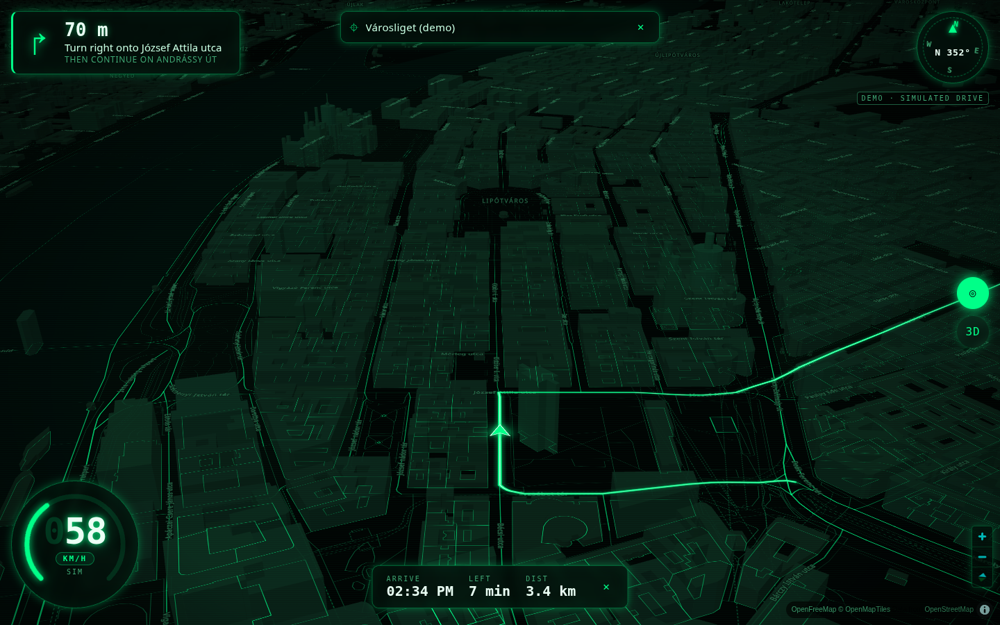

# Navigation applet

A dark, 3D, green-vector navigation map for JARVIS. It has:

- tilted vector map, near-black base, neon-green outlines for roads, water, parks and buildings
- translucent extruded buildings and a glowing green route
- live speed readout (km/h ⇄ mph), heading compass, next-turn card and ETA
- a follow-me camera that eases to your position and direction of travel

All data is **free and needs no API key**:

| What | Service | Notes |
| --- | --- | --- |
| Map tiles | [OpenFreeMap](https://openfreemap.org) vector tiles (OpenMapTiles schema, OpenStreetMap data) | No key, no registration. Attribution shown on the map. |
| Map engine | [MapLibre GL JS](https://maplibre.org) 5.24.0 from unpkg (fallback jsDelivr) | WebGL; renders 3D extrusions and pitch. |
| Routing | [OSRM](https://project-osrm.org) public demo server (`router.project-osrm.org`) | Driving profile, turn-by-turn steps. |
| Search | [Photon](https://photon.komoot.io), falling back to [Nominatim](https://nominatim.org) | Photon supports search-as-you-type; Nominatim is only asked when Photon fails. |

The browser only fetches tiles, fonts and MapLibre itself. Search and routing go through this applet's
server, which:

- caches results for 10 minutes
- spaces Nominatim calls at least 1.1 s apart
- sends an identifying `User-Agent`

That keeps us inside the public services' usage policies for personal, low-volume use. For heavy use,
point the URLs at your own OSRM, Photon or Nominatim (see Configuration).



## Run

```bash
node applets/navigation/server.js              # http://127.0.0.1:8731/
# then open http://127.0.0.1:8731/?demo=1      # simulated drive, no GPS needed
```

No build step and no npm install beyond the repo itself. The server is plain Node 22 ESM and serves
everything with **relative URLs**, so it works both at `/` and behind the App Cloud proxy at
`/api/nodes/<node>/apps/navigation/`.

| Endpoint | Returns |
| --- | --- |
| `GET healthz` | `{"ok":true}` |
| `GET config.json` | `{tiles, glyphs, demo, provider}`: the public endpoints the browser loads |
| `GET api/search?q=…&near=lon,lat` | `{results:[{label, detail, lon, lat}]}` |
| `GET api/route?from=lon,lat&to=lon,lat` | `{distance, duration, geometry:[[lon,lat]…], steps:[{type, modifier, name, location, distance, duration}]}` |

### Demo mode

`?demo=1` fetches a real route through central Budapest, from Deák tér up Andrássy út to Városliget. A
simulated vehicle drives it at 5 Hz:

- it speeds up, cruises between roughly 30 and 75 km/h, and brakes for each turn
- the speed readout, compass, next-turn card, ETA and 3D follow camera all run exactly as with GPS
- at the end it loops

Searching for a destination in demo mode drives there instead. If the routing service is down, the demo
falls back to a built-in line, so it still works.

## Configuration

Everything is optional. Environment variables win over `~/.rigs/config.json` → `navigation`, which wins
over the defaults:

| Env | `navigation.<key>` | Default |
| --- | --- | --- |
| `NAV_PORT` | `port` | `8731` |
| `NAV_HOST` | `host` | `127.0.0.1` (the App Cloud proxy reaches it locally) |
| `NAV_TILES_URL` | `tilesUrl` | `https://tiles.openfreemap.org/planet` (TileJSON, OpenMapTiles schema) |
| `NAV_GLYPHS_URL` | `glyphsUrl` | `https://tiles.openfreemap.org/fonts/{fontstack}/{range}.pbf` |
| `NAV_ROUTING_URL` | `routingUrl` | `https://router.project-osrm.org` |
| `NAV_SEARCH_URL` | `searchUrl` | `https://photon.komoot.io` |
| `NAV_NOMINATIM_URL` | `nominatimUrl` | `https://nominatim.openstreetmap.org` |
| — | `demo.from`, `demo.to` | `[19.0548, 47.4979]` → `[19.0838, 47.5155]` (`[lon, lat]`) |

```json
{ "navigation": { "demo": { "from": [13.3777, 52.5163], "to": [13.4050, 52.5200] } } }
```

Any OpenMapTiles-schema source works for `tilesUrl`. That includes a self-hosted OpenFreeMap or
Planetiler build, or MapTiler with your own key in the URL. If you put a key there, keep it in
`~/.rigs/config.json` or the environment, never in this repo. Invalid values are ignored with a log
warning that names the setting but not its value.

## The look

The style lives in `public/mapstyle.js`, built in code over the OpenMapTiles layers:

- background `#010403`
- parks and water filled near-black
- roads as `#00ff88`-family strokes; width and brightness go up with road class
- water, park and building edges as thin green lines
- buildings as dark-green translucent extrusions, footprint lines drawn on top
- road, place and water labels in muted green `#3fa774`
- no POI, house-number or peak layers

Change `PALETTE` there to retune it.

## GPS, HTTPS and the secure-context rule

Browsers only allow `navigator.geolocation` in a **secure context**: `https://…` or `http://localhost`.

- **Plain-HTTP tailnet address** (for example `http://100.x.y.z:4719`): the page can't read your
  location. It says so and offers the demo. To use GPS from a phone, reach JARVIS over HTTPS, for
  example with Tailscale's `tailscale serve` HTTPS proxy in front of the RIGS port.
- **Inside JARVIS**: the app window's iframe grants `geolocation` (`ui/src/apps.js`), so the permission
  prompt comes from the JARVIS page.
- **Speed source**: the readout uses `coords.speed` when the device reports it (tagged `GPS`). Otherwise
  it derives speed from successive fixes with the haversine distance, smoothed over about 4 s, and
  ignores jitter while parked (tagged `CALC`). Demo mode shows `SIM`.

## When something is missing

The page never goes blank. It shows a styled screen with a Retry button if:

- the applet server is unreachable
- MapLibre can't be downloaded
- WebGL is off

See `docs/screenshot-no-webgl.png`. Tile, routing and search failures show a short status line instead
of an error.

## Tests and screenshots

- `npm test` runs `test/navigation.test.js`. It covers the haversine maths, speed from fixes, unit
  conversion, route progress and ETA, the style rules, config loading, and the server endpoints against a
  fake upstream.
- `node applets/navigation/scripts/screenshot.js <url> <out.png> 1440x900 --swiftshader` takes a
  headless-Chrome screenshot. It also prints speed samples, console errors and failed requests.
  `--swiftshader` gives headless Chrome a software WebGL.
